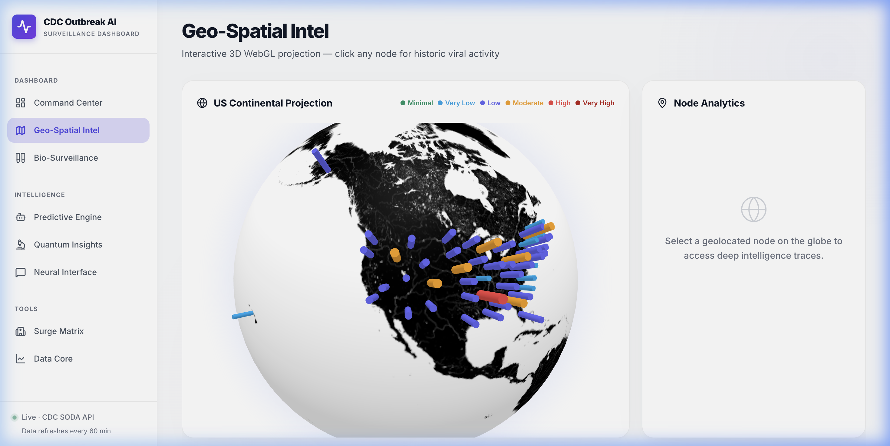

# CDC Outbreak Dashboard

**Live site:** https://neelvadlamudi.github.io/cdc-outbreak-dashboard/ · **Portfolio:** https://neelvadlamudi.github.io/neelresume/

**Pipeline:** CDC open data → DuckDB → FastAPI → grounded tool-calling agent → nightly evals & forecast backtests.

A surveillance assistant over public U.S. respiratory virus data (COVID-19, influenza, RSV). The product answers with tools and measured scores — not free-form “smart” chat. Outlooks default to **last-week persistence**; LSTM/XGBoost are experimental and labelled when they underperform that baseline.



## Proven vs experimental (60 seconds)

| Layer | Status |
| --- | --- |
| CDC → DuckDB ingestion + `/api` reads | Proven; nightly refresh publishes a live DuckDB artifact |
| `POST /api/agent/ask` tool agent + number checker | Proven; scored on frozen `evals/snapshot.duckdb` (`cdc-q60-v1`) |
| Last-value / persistence outlook | **Primary** product outlook |
| LSTM / XGBoost | **Experimental** — shown with underperforms-baseline when backtests lose |
| Anomaly flags | z-score (|z| > 2), not Isolation Forest |
| Unverified `/api/chat` | **Retired** (HTTP 410 → use `/api/agent/ask`) |

## Case study — measuring production AI

Two lessons the nightlies forced into the product:

1. **Grounding regression (`14` bug).** A stale-table warning path injected a day-count that never appeared in tool output. Numeric answers looked fine, but `grounded_answers` collapsed (e.g. 16.7% on 2026-11-04) because the scorer requires every figure to appear in tool results. Fix: keep the warning text free of invented numbers ([`backend/agent/graph.py`](backend/agent/graph.py)). CI can gate `grounded_answers` vs [`evals/baseline.json`](evals/baseline.json) when a clean artifact is supplied (`scripts/check_grounding_gate.py`).
2. **Forecast honesty.** Rolling-origin backtests show LSTM/XGBoost rarely beat repeating last week on these sparse weekly series. The UI and `get_forecast` therefore lead with last-value and badge experimental models — not “train harder forever.”

## 60-second demo script

1. Open the [live site](https://neelvadlamudi.github.io/cdc-outbreak-dashboard/) — show nightly status + freshness chips.
2. Ask three questions in Try it live / React Ask: positivity this week; a state ARI level; a pediatric rate (age_group required). Expand tool tables under each answer.
3. Open Eval scores + Forecast backtest — point at last-value vs LSTM/XGBoost MAE; note experimental language on Outlook.

## What the code does

- **Data ingestion** (`backend/cdc_ingestion.py`): downloads four public datasets from data.cdc.gov, cleans them with pandas and loads them into DuckDB.
- **Query API** (`backend/routes.py`): read-only endpoints under `/api` for activity, hospitalizations, positivity, wastewater, dashboard summary, health (`as_of` + per-table stale flags), and SSE.
- **Outlook** (`backend/forecasting.py`): `GET /api/forecast/{virus}` returns **last-value primary**; LSTM is nested under `experimental_models` when a saved model exists. Never trains on GET.
- **XGBoost** (`backend/ensemble.py`): experimental; compare endpoint also returns last-value primary. Anomalies use **z-score** only.
- **Backtest:** published notes attach to forecast/compare responses; models that lose get `underperforms_baseline`.
- **Agent** (`backend/agent/`): `POST /api/agent/ask` only (verified tools + checker). Exact-week misses refuse; pediatric questions need age_group args. `POST /api/chat` returns **410**.
- **MCP server** (`backend/mcp_server.py`): same tools over MCP.
- **Capacity simulator** (`backend/simulator.py`): Monte Carlo bed/ICU demand.
- **Frontend** (`frontend/`): React + Vite; typed agent contract (`contract.ts` / `api.ts` / `AskData.tsx`).

## Live DuckDB vs frozen eval snapshot

| File | Role |
| --- | --- |
| Nightly `CDC_DB_PATH` + Actions artifact `cdc-duckdb` | Fresh CDC tables for the live API (≤ ~24–36h lag when `CDC_DB_URL` is set on Render) |
| `evals/snapshot.duckdb` | **Frozen** for reproducible 60-q evals — do not overwrite with live pulls |

`scripts/fetch_live_db.py` downloads `CDC_DB_URL` or falls back to the snapshot. See `render.yaml`.

## Running locally

Requirements: Python 3.10+ and Node.js 18+.

### Backend

```bash
python -m venv .venv
source .venv/bin/activate
pip install -r requirements.txt
cp .env.example .env
set -a; source .env; set +a
uvicorn backend.main:app --reload
```

### Frontend

```bash
cd frontend && npm ci && npm run dev
```

## Configuration

See `.env.example`. Notable vars: `CDC_DB_PATH`, `CDC_DB_URL`, `INGEST_ON_STARTUP`, `AGENT_MODEL`, `GEMINI_API_KEY`, `RATE_LIMIT_BACKEND` (`sqlite` default / `memory` / `redis` + `REDIS_URL`), `STALE_AFTER_DAYS`.

Ask:

```bash
curl -X POST -H "Content-Type: application/json" \
  -d '{"question": "What is COVID-19 test positivity this week?"}' \
  http://localhost:8000/api/agent/ask
```

## Development

```bash
make run    # API with reload
make test   # pytest
make lint   # ruff (same as CI)
make check  # lint + test before push
make eval   # 60-question eval (needs model + snapshot)
```

**Before push:** run `make check` (or `scripts/check.sh`). Optional pre-commit hook so unused-import / ruff failures never reach CI again:

```bash
pip install pre-commit
pre-commit install   # uses .pre-commit-config.yaml (ruff check)
```

## Nightly run

`.github/workflows/nightly.yml` (09:17 UTC): refresh CDC data → upload `cdc-duckdb` artifact → backtest → dashboard → 60-q eval on **frozen snapshot** → `status.json` → commit site data → alert issues.

Alerts when a rate drops >5pts vs `evals/baseline.json`, a current table is stale, or a step fails. **Baseline bump:** only after a clean post-fix eval summary — see the `note` in `evals/baseline.json` (not bumped in Path-to-Ten without a new Gemini run).

CI runs `scripts/check_grounding_gate.py` (skips unless `evals/ci_eval_result.json` or `EVAL_RESULT_PATH` is set).

## Deployment

`render.yaml` targets a **starter** (always-on) plan with a persistent disk and `fetch_live_db.py`. **You must click Upgrade in the Render UI** — the blueprint cannot change billing by itself. Until `CDC_DB_URL` points at a published nightly DuckDB, the service falls back to the frozen snapshot.

- Health: `GET /api/health` (tables + stale flags).
- Rate limits: SQLite file by default (`RATE_LIMIT_DB`); optional Redis via env.
- `/api/chat` is gone (410). Limits apply to `/api/agent/ask` and `/api/weekly-brief`.
- CORS: Pages origin. Secrets: `GEMINI_API_KEY`, `CDC_DB_URL`.

## Release tag (v1.0)

When Phases 1–3 exit criteria are green on a clean tree:

```bash
git tag -a v1.0 -m "v1.0: grounded agent, honest last-value outlook, live DuckDB path"
git push origin v1.0
```

Do not force-push tags. If the working tree is dirty, commit first or leave the tag for after merge.

## Data source

Public CDC datasets on [data.cdc.gov](https://data.cdc.gov). **Not affiliated with the CDC.**
