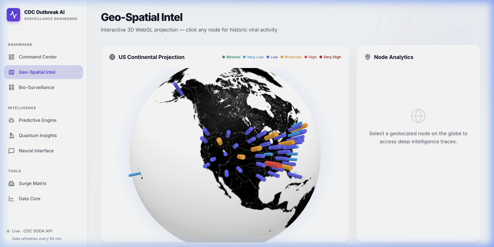

# CDC Outbreak Dashboard

A dashboard for U.S. respiratory virus surveillance data (COVID-19, influenza and RSV). The backend downloads public CDC datasets through the Socrata Open Data API (SODA), stores them in a local DuckDB file and serves them through a FastAPI application. The frontend is a React application built with Vite.



## What the code does

- **Data ingestion** (`backend/cdc_ingestion.py`): downloads four public datasets from data.cdc.gov (acute respiratory illness activity by state, RESP-NET hospitalization rates, test positivity, and NWSS wastewater surveillance), cleans them with pandas and loads them into DuckDB. Ingestion runs at startup and then every 60 minutes.
- **Query API** (`backend/routes.py`): read-only endpoints under `/api` for activity levels, hospitalization rates, test positivity, wastewater data, a dashboard summary and a server-sent event stream. SQL queries use bound parameters.
- **LSTM forecast** (`backend/forecasting.py`): a PyTorch LSTM trained on weekly hospitalization rates with lag, rolling-mean and seasonal sine/cosine features. It predicts four weeks ahead and reports validation MAE. The forecast band is the MAE scaled by a factor that grows with the horizon; it is not a statistical interval.
- **XGBoost forecast** (`backend/ensemble.py`): a gradient-boosted model on lag features. `/api/ensemble/compare/{virus}` returns the LSTM and XGBoost forecasts side by side. The same module flags anomalies with an Isolation Forest and builds age-group and season comparison data.
- **LLM agent** (`backend/agent/`): `POST /api/agent/ask` answers a question with a LangGraph loop that calls seven read-only data tools (`backend/agent/tools.py`), at most six calls per question. The tools check inputs against values found in the data and return JSON with `as_of`, `rows` and `source_table`. The model is Gemini Flash-Lite or a local Ollama model, chosen with `AGENT_MODEL`. The system prompt is in `backend/agent/prompts/system_v1.md`. Every number in an answer must appear in a tool result; otherwise the answer is replaced with "I could not verify that figure" and logged to `evals/review_queue.jsonl`. Answers that rely on tables older than 14 days carry a warning. The response includes a `status` of `answered`, `refused` or `unverified`. If no model is reachable, the older rule-based chat answers instead.
- **MCP server** (`backend/mcp_server.py`): serves the same seven tools over the Model Context Protocol (`python -m backend.mcp_server`). The agent calls the tool functions directly rather than through this server.
- **Capacity simulator** (`backend/simulator.py`): a Monte Carlo model of hospital bed and ICU demand under a user-chosen surge scenario, reporting the mean and the 5th and 95th percentiles.
- **Frontend** (`frontend/`): React pages for an overview, a map built with `react-globe.gl`, charts built with Plotly, forecasts, wastewater, the simulator and the chat.

## Running locally

Requirements: Python 3.10 or later and Node.js 18 or later.

### Backend

Run these commands from the repository root:

```bash
python -m venv .venv
source .venv/bin/activate   # Windows: .venv\Scripts\activate
pip install -r requirements.txt
cp .env.example .env        # then edit the values
set -a; source .env; set +a # load the settings into the shell
uvicorn backend.main:app --reload
```

The API runs at http://localhost:8000 and the interactive documentation at http://localhost:8000/docs. The first start downloads the CDC datasets, which takes a few minutes.

### Frontend

```bash
cd frontend
npm install
npm run dev
```

The frontend runs at http://localhost:5173.

## Configuration

All settings are read from environment variables. `.env.example` lists each one.

| Variable | Purpose | Default |
| --- | --- | --- |
| `ALLOWED_ORIGINS` | Comma-separated origins allowed by CORS | `http://localhost:5173` |
| `ADMIN_API_KEY` | Key required in the `X-API-Key` header for the training endpoints; if unset, training is disabled | unset |
| `CDC_DB_PATH` | DuckDB file the app reads and writes | `data/cdc_surveillance.duckdb` |
| `AGENT_MODEL` | `gemini-flash-lite` or `ollama-local` | `gemini-flash-lite` |
| `GEMINI_API_KEY` | Gemini API key for the agent | unset |
| `GEMINI_MODEL_ID` | Gemini model id | `gemini-3.5-flash-lite` |
| `OLLAMA_AGENT_MODEL` | Ollama model for the agent | `qwen2.5:7b` |
| `STALE_AFTER_DAYS` | Age at which a table is reported as stale | `14` |
| `REVIEW_QUEUE_PATH` | File for answers that fail the number checker | `evals/review_queue.jsonl` |
| `OLLAMA_MODEL` | Ollama model used by the chat endpoint | `mistral` |
| `LOG_LEVEL` | Python logging level | `INFO` |
| `VITE_API_URL` | API base URL used by the frontend at build time | `http://localhost:8000/api` |

Models are trained from the command line only; the frontend has no training buttons. With the API running, the training endpoints `POST /api/forecast/train/{virus}` and `POST /api/ensemble/train/{virus}` require the header `X-API-Key: <ADMIN_API_KEY>`, for example:

```bash
curl -X POST -H "X-API-Key: $ADMIN_API_KEY" http://localhost:8000/api/forecast/train/COVID-NET
curl -X POST -H "X-API-Key: $ADMIN_API_KEY" http://localhost:8000/api/ensemble/train/COVID-NET
```

Ask the agent a question:

```bash
curl -X POST -H "Content-Type: application/json" -d '{"question": "What is COVID-19 test positivity this week?"}' http://localhost:8000/api/agent/ask
```

The NWSS wastewater dataset the app uses has no records after 2025-09-07, so wastewater questions are reported as not covered.

## Development

```bash
make run    # start the API with reload
make test   # run pytest
make lint   # run ruff
make eval   # placeholder until an evaluation suite exists
```

## Deployment

`render.yaml` defines a Render web service for the API and a static site for the frontend. The `Dockerfile` builds the frontend and runs the API with `uvicorn backend.main:app`.

## Data source

All data comes from public CDC datasets on [data.cdc.gov](https://data.cdc.gov). This project is not affiliated with the CDC.
